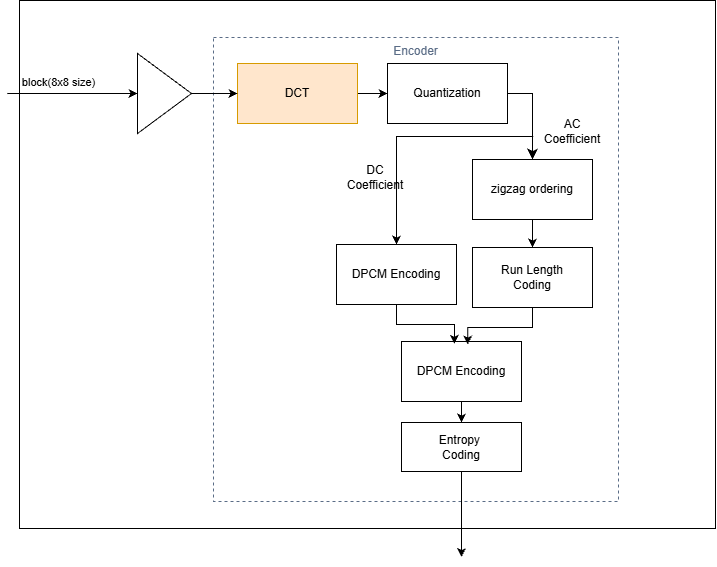
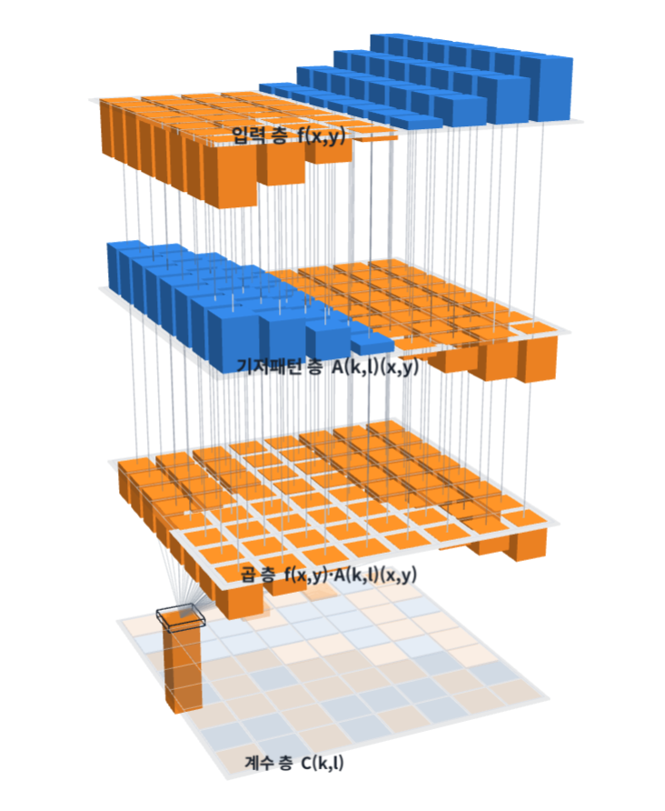

요약: 영상처리, 특히 압축 중 DCT란 무엇이고 왜 필요한가?

## DCT란 무엇일까?

DCT(Discrete Cosine Transform)이란, 한 이미지 내(intra)에서 공간적인 중복(spatial redundancy)를 줄이기 위한 방법이다.

실제 이미지 내에서 픽셀들을 생각해보면, 중복이 꽤나 많다.

위의 이미지를 보면 피부나 배경이 거의 대부분 비슷한 색상이거나, 부드럽게 변하는 것을 확인할 수 있다. '중복'인 것이다.

DCT는 transform coding 방법 중 하나로, 이미지를 블록 단위로 받아서 주파수 성분들로 변환한 뒤, 후에 양자화를 거쳐 이 중복을 없앨 수 있다. (lossy, 즉 data 손실이 일어나는 coding이다.)
> 중복을 꼭 없애야하나? 하고 궁금할 수 있는데, 1시간짜리 60fps HD화질의 영화를 생각해보자. 8bits bit-depth를 생각한다.
> - 1920x1080 * 3 * 8 * 60장/s * 3600 / (8bytes/bits) = 1.3436928e+12 = 약 1,300GB = 약 1TB이다.
> - 30fps여도 0.5TB인데, 전세계 사람들이 넷플릭스를 보는 동안, 전송 N/W에 과부화가 일어날 것이다.

(이때, 블록 단위라는 것은 단순히 pixel개수 nxn으로 이미지를 분할하는 것을 말한다. 실험결과, 압축 정도와 효율간의 균형을 이루는 지점이 8x8이라고 한다.)

실험에 따르면, 
1. 사람들은 image상의 높은 주파수 성분(자잘한 변화 - 옷의 직교한 세세한 직물 패턴 등)에는 둔감하다고 한다.
2. 사람은 밝기(luminance)의 변화에 상대적으로 민감하지, 색상(chrominance)의 변화에는 상대적으로 둔감하다고 한다.

여기서 2번의 경우는 `chroma subsampling`이라는 기법으로 여기선 다루지 않는다.

1번이 이 포스팅에서 다룰 내용과 관계가 있다. DCT의 사용 근거가 되기 때문이다.

## DCT는 영상처리 과정 중 어디에 위치해있나?

DCT가 왜 필요하고, 그렇다면 DCT는 영상처리 과정 중 어디에 속해있을까?

위의 색칠한 Transform 부분이 DCT를 사용하는 구간이다.

처음 카메라(기록장치?)를 통해 들어온 영상이 Encoder 내부에서 변형되고, 양자화되고, bitstream화 되면서(Entropy Coding) 전송선로를 따라 Decoder에 도착하게 된다.

Decoder에서는 역으로 Entropy Coding과(bits stream-> symbol), invderse transform(여기선 Inverse DCT)를 거쳐 display기기에 나타난다.

### 영상처리과정 실제 예시 - JPEG

  
참고: Level-shift

    <blockquote>
    JPEG에서는 DCT 수행 전에 Preprocessing 과정이 있고, 여기에서 "Level-Shift"를 한다. 
     
    픽셀이 8bits로 표현될 때(bit-depth) 0~255까지 그 값이 나타나므로, -128을 해줘서 -128~127로 구간을 이동시키는 것이다. 이렇게 하면 DCT 결과로 나오는 DC계수의 크기가 주는 효과가 있다.  
    - 크기가 준다는 것은 보낼 비트수가 적어진다는 뜻이다.</blockquote>

JPEG에서는 DCT 결과로 나온 DC 계수를 DPCM Encoding으로 처리해서 보내고, AC 계수들은 Zigzag Ordering -> Run Length Encoding으로 처리한다. 

간단히 설명하면, 좌표에 따른 픽셀 값들은 DCT를 거쳐 주파수 도메인의 '계수'표 형태로 나타내게 되는데, 이때 (0,0) 좌표에 위치하게 되는 성분은 DC 성분이고, 그 외 나머지는 AC성분이다. 

또, 이 표 상에서 우하귀로 갈수록 높은 주파수 성분이 된다. Zigzag ordering이나 Run Length Encoding 모두 이런 특성을 이용해 압축하는 방법들이다. 아래 예시를 하나 들겠다.
> 원본 픽셀값이 DCT 처리를 거쳐 주파수 성분별 계수로 나타난 두 표를 비교한다.
> - 잘 보면, DCT 계수표에서는 우하귀로 갈수록(고주파 성분일수록) 그 절대값이 작아진다. = 양자화 때 0으로 변환된다. = 전송 데이터를 줄인다.

원본 픽셀값 f(x,y) (흑백, 8비트 깊이, 단위: 0~255 밝기 단계)
{: #tables-compare}

<table border="1" cellpadding="6" cellspacing="0" style="border-collapse:collapse;text-align:center;">
<tr><th style="background:#eeeeee;color:#000000;">y＼x</th><th style="background:#eeeeee;color:#000000;">0</th><th style="background:#eeeeee;color:#000000;">1</th><th style="background:#eeeeee;color:#000000;">2</th><th style="background:#eeeeee;color:#000000;">3</th><th style="background:#eeeeee;color:#000000;">4</th><th style="background:#eeeeee;color:#000000;">5</th><th style="background:#eeeeee;color:#000000;">6</th><th style="background:#eeeeee;color:#000000;">7</th></tr>
<tr><th style="background:#eeeeee;color:#000000;">0</th><td>52</td><td>55</td><td>61</td><td>66</td><td>70</td><td>61</td><td>64</td><td>73</td></tr>
<tr><th style="background:#eeeeee;color:#000000;">1</th><td>63</td><td>59</td><td>55</td><td>90</td><td>109</td><td>85</td><td>69</td><td>72</td></tr>
<tr><th style="background:#eeeeee;color:#000000;">2</th><td>62</td><td>59</td><td>68</td><td>113</td><td>144</td><td>104</td><td>66</td><td>73</td></tr>
<tr><th style="background:#eeeeee;color:#000000;">3</th><td>63</td><td>58</td><td>71</td><td>122</td><td>154</td><td>106</td><td>70</td><td>69</td></tr>
<tr><th style="background:#eeeeee;color:#000000;">4</th><td>67</td><td>61</td><td>68</td><td>104</td><td>126</td><td>88</td><td>68</td><td>70</td></tr>
<tr><th style="background:#eeeeee;color:#000000;">5</th><td>79</td><td>65</td><td>60</td><td>70</td><td>77</td><td>68</td><td>58</td><td>75</td></tr>
<tr><th style="background:#eeeeee;color:#000000;">6</th><td>85</td><td>71</td><td>64</td><td>59</td><td>55</td><td>61</td><td>65</td><td>83</td></tr>
<tr><th style="background:#eeeeee;color:#000000;">7</th><td>87</td><td>79</td><td>69</td><td>68</td><td>65</td><td>76</td><td>78</td><td>94</td></tr>
</table>

DCT 계수표 C(k,l) (128을 뺀 픽셀값 단계, 소수 둘째 자리에서 반올림)

<table border="1" cellpadding="6" cellspacing="0" style="border-collapse:collapse;text-align:center;">
<tr><th style="background:#eeeeee;color:#000000;">l＼k</th><th style="background:#eeeeee;color:#000000;">0</th><th style="background:#eeeeee;color:#000000;">1</th><th style="background:#eeeeee;color:#000000;">2</th><th style="background:#eeeeee;color:#000000;">3</th><th style="background:#eeeeee;color:#000000;">4</th><th style="background:#eeeeee;color:#000000;">5</th><th style="background:#eeeeee;color:#000000;">6</th><th style="background:#eeeeee;color:#000000;">7</th></tr>
<tr><th style="background:#eeeeee;color:#000000;">0</th><td><b>−415.4</b></td><td>−30.2</td><td>−61.2</td><td>27.2</td><td>56.1</td><td>−20.1</td><td>−2.4</td><td>0.5</td></tr>
<tr><th style="background:#eeeeee;color:#000000;">1</th><td>4.5</td><td>−21.9</td><td>−60.8</td><td>10.3</td><td>13.1</td><td>−7.1</td><td>−8.5</td><td>4.9</td></tr>
<tr><th style="background:#eeeeee;color:#000000;">2</th><td>−46.8</td><td>7.4</td><td>77.1</td><td>−24.6</td><td>−28.9</td><td>9.9</td><td>5.4</td><td>−5.6</td></tr>
<tr><th style="background:#eeeeee;color:#000000;">3</th><td>−48.5</td><td>12.1</td><td>34.1</td><td>−14.8</td><td>−10.2</td><td>6.3</td><td>1.8</td><td>1.9</td></tr>
<tr><th style="background:#eeeeee;color:#000000;">4</th><td>12.1</td><td>−6.6</td><td>−13.2</td><td>−4.0</td><td>−1.9</td><td>1.7</td><td>−2.8</td><td>3.1</td></tr>
<tr><th style="background:#eeeeee;color:#000000;">5</th><td>−7.7</td><td>2.9</td><td>2.4</td><td>−5.9</td><td>−2.4</td><td>0.9</td><td>4.3</td><td>1.8</td></tr>
<tr><th style="background:#eeeeee;color:#000000;">6</th><td>−1.0</td><td>0.2</td><td>0.4</td><td>−2.4</td><td>−0.9</td><td>−3.0</td><td>4.1</td><td>−0.7</td></tr>
<tr><th style="background:#eeeeee;color:#000000;">7</th><td>−0.2</td><td>0.1</td><td>−1.1</td><td>−4.2</td><td>−1.2</td><td>−0.1</td><td>0.5</td><td>1.7</td></tr>
</table>

## DCT 수식

이제 미뤄두었던 수식을 볼 차례이다.

### 사전정의

- (u,v)는 DCT 결과로 나온 계수표 상의 위치이다.
- (x,y), (m,n) 또는 (i,j)는 모두 영상(=이미지) 블록의 공간 위치상의 좌표이다(2-D 상의 특정 픽셀이다.).
- F(u,v)는 DCT 계수 표를 나타낸다. 즉, F는 DCT 라고 할 수 있다. (f는 Inverse DCT이다.)

### 수식

NxN 이미지(영상)에 대하여,

$$F(u,v) = \frac{2}{N}C(u)C(v)[\sum_{x=0}^{N-1} \sum_{y=0}^{N-1} f(x,y) \times \cos{\frac{(2x+1)u\pi}{2N}} \cos{\frac{(2y+1)v\pi}{2N}} ]$$
$$where:
\begin{cases}
C(u),C(v)=\frac{1}{\sqrt{2}} & for u,v =0, \\
C(u),C(v)=1 & otherwise
\end{cases}$$

반대로, Inverse DCT는

$$f(x,y) = \frac{2}{N}[\sum_{u=0}^{N-1} \sum_{v=0}^{N-1} C(u)C(v) \times F(u,v) \times \cos{\frac{(2x+1)u\pi}{2N}} \cos{\frac{(2y+1)v\pi}{2N}} ]$$

DCT는 계산량과 화질 사이의 절충이 8X8이라고 알려져있으므로, N에 8을 넣으면 되겠다.

위 $F(u,v)$는 DCT계수표의 원소 8x8 64개를 채워야하므로, 각(u,v)에 대해 (x,y)의 64개를 합해줘야 한다. 즉 64x64번의 계산량이다.

이걸 한번에 행렬식으로도 나타낼 수 있다.

$$F(u,v) = \mathbf{Y} = \mathbf{AX{A^T}}$$

훨씬 간단하다. 입력 X를 양 옆에서 $\mathbf{A}$, $\mathbf{A^T}$ 행렬곱을 해주면 된다. 
> 즉, 기저를 변환시킨 transform이다. 이때, $\mathbf{A}$는 **정규직교인 기저들을 행방향으로 쌓은 행렬**이다. 즉 $\mathbf{A^T}$ = $\mathbf{A^{-1}}$이다.
> - 정규직교: basis들이 각각 크기는 1이고, 서로 orthogonal하다.

수식 설명과 DCT과정 시각화에 앞서, 수식으로부터 몇 가지 특이한 점을 간단히 살펴보자면, 

1. $\frac{1}{4}C(u)C(v)$
    나중에 설명하겠지만, 지금 뒤에 $\cos()$들을 보면 각각 x,u에 관한 식, y,v에 관한 식으로 각각 나뉘어있다. 
    즉, 이 식은(F나 f나) x,y 방향 각각에 대해 독립적인 두 식으로 분리가 가능한데, 앞의 계수 $\frac{1}{4}C(u)C(v)$는 $\frac{1}{2}C(u)$ 두 개로 분리가 가능하다. (separable)
    또, 여기서 C(u)/2는 선형대수에서 transform 후에도 Norm이 같으려면, 즉 신호처리에서는 transform 후에도 그 에너지가 보존되려면 scaling이 필요하기 때문에 붙여주는 계수(정규화 상수)이다.

2. separable
    위 1번의 separable 성질이 유용하게 쓰인다. $\sum_{x=0}^{N-1}$과 $\sum_{y=0}^{N-1}$

3. $\frac{(2i+1)}{2N}$
    픽셀 ㅁ 을 생각하면, 왼쪽 아래 모서리 지점을 i라고 할 때, i와 i+1의 가운데, 즉 $\frac{1}{2}$이다.
    N으로 나눈 것은 좌표(i,j)가 이미지 전체에 걸쳐, 즉 블록들 사이에 걸쳐 있으므로, 한 블록(NxN) 내에서의 상대적 위치를 나타내기 위함이다.

4. 정규직교인 기저(basis)들을 행 방향으로 쌓은 행렬 $\mathbf{A}$
    각 basis들에 대해 

5. cosine이 왜 곱해지냐?
    이건 나도 잘 모르겠다. 내적이라서 그런건지, 트랜스포머 모델에서 위치를 나타내기 위해서 쓰듯 여기서도 쓰는 건지.
    - cosine 형태의 파형(신호)로 나타내기 위해서인 것 같다.
    - DCT는 정지해 있는 픽셀값(이산적 위치 신호)를 서로 다른 주기를 가진 코사인 파형들의 합으로 분해하는 변환이라고 할 수 있다.

### DCT의 시각화

[앞에 등장했던 표와 함께 비교해보자.](#tables-compare)

