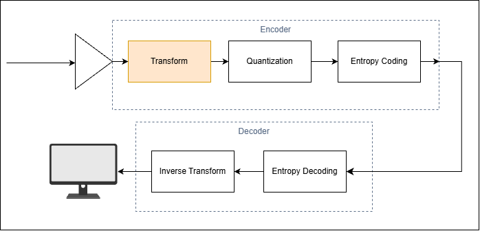
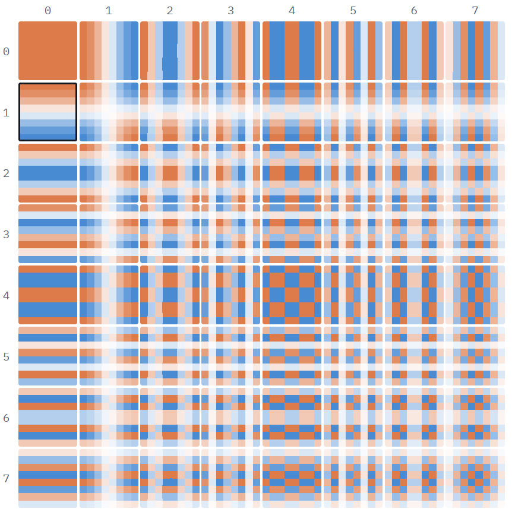
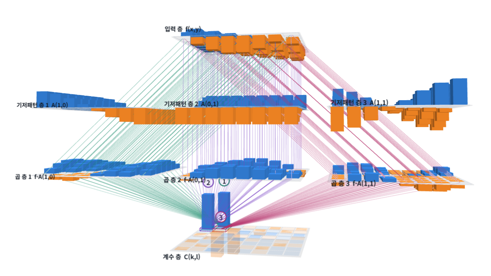
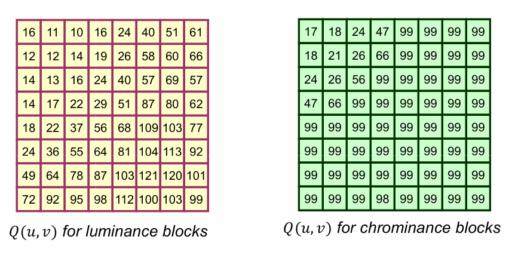

요약: 영상처리, 특히 압축 중 DCT란 무엇이고 왜 필요한가?

## DCT란 무엇일까?

DCT(Discrete Cosine Transform)이란, 한 이미지 내(intra)에서 공간적인 중복(spatial redundancy)를 줄이기 위한 방법이다.

실제 이미지 내에서 픽셀들을 생각해보면, 중복이 꽤나 많다.

위의 이미지를 보면 피부나 배경이 거의 대부분 비슷한 색상이거나, 부드럽게 변하는 것을 확인할 수 있다. '중복'인 것이다.

DCT는 transform coding 방법 중 하나로, 이미지를 블록 단위로 받아서 주파수 성분들로 변환한 뒤, 후에 양자화를 거쳐 이 중복을 없앨 수 있다. (lossy, 즉 data 손실이 일어나는 coding이다.)
> 중복을 꼭 없애야하나? 하고 궁금할 수 있는데, 1시간짜리 60fps HD화질의 영화를 생각해보자. 8bits bit-depth를 생각한다.
> - 1920x1080 * 3 * 8 * 60장/s * 3600 / (8bytes/bits) = 1.3436928e+12 = 약 1,300GB = 약 1TB이다.
> - 30fps여도 0.5TB인데, 전세계 사람들이 넷플릭스를 보는 동안, 전송 N/W에 과부화가 일어날 것이다.

(이때, 블록 단위라는 것은 단순히 pixel개수 nxn으로 이미지를 분할하는 것을 말한다. 실험결과, 압축 정도와 효율간의 균형을 이루는 지점이 8x8이라고 한다.)

실험에 따르면, 
1. 사람들은 image상의 높은 주파수 성분(자잘한 변화 - 옷의 직교한 세세한 직물 패턴 등)에는 둔감하다고 한다.
2. 사람은 밝기(luminance)의 변화에 상대적으로 민감하지, 색상(chrominance)의 변화에는 상대적으로 둔감하다고 한다.

여기서 2번의 경우는 `chroma subsampling`이라는 기법으로 여기선 다루지 않는다.

1번이 이 포스팅에서 다룰 내용과 관계가 있다. DCT의 사용 근거가 되기 때문이다.

## DCT는 영상처리 과정 중 어디에 위치해있나?

DCT가 왜 필요하고, 그렇다면 DCT는 영상처리 과정 중 어디에 속해있을까?

위의 색칠한 Transform 부분이 DCT를 사용하는 구간이다.

처음 카메라(기록장치?)를 통해 들어온 영상이 Encoder 내부에서 변형되고, 양자화되고, bitstream화 되면서(Entropy Coding) 전송선로를 따라 Decoder에 도착하게 된다.

Decoder에서는 역으로 Entropy Coding과(bits stream-> symbol), invderse transform(여기선 Inverse DCT)를 거쳐 display기기에 나타난다.

### 영상처리과정 실제 예시 - JPEG

  
참고: Level-shift

    <blockquote>
    JPEG에서는 DCT 수행 전에 Preprocessing 과정이 있고, 여기에서 "Level-Shift"를 한다. 
     
    픽셀이 8bits로 표현될 때(bit-depth) 0~255까지 그 값이 나타나므로, -128을 해줘서 -128~127로 구간을 이동시키는 것이다. 이렇게 하면 DCT 결과로 나오는 DC계수의 크기가 주는 효과가 있다.  
    - 크기가 준다는 것은 보낼 비트수가 적어진다는 뜻이다.</blockquote>

JPEG에서는 DCT 결과로 나온 DC 계수를 DPCM Encoding으로 처리해서 보내고, AC 계수들은 Zigzag Ordering -> Run Length Encoding으로 처리한다. 
> - DC: 8x8 이차원 픽셀 각각의 값을 평균낸 뒤 8배한 값. Y/Cb/Cr 혹은 흑백 사진이면 밝기 값이다.(8비트로 나타내는 8bits depth일 때 0~255)
> - AC: 주파수 별 성분

간단히 설명하면, 좌표에 따른 픽셀 값들은 DCT를 거쳐 주파수 도메인의 '계수'표 형태로 나타내게 되는데, 이때 (0,0) 좌표에 위치하게 되는 성분은 DC 성분이고, 그 외 나머지는 AC성분이다. 

또, 이 표 상에서 우하귀로 갈수록 높은 주파수 성분이 된다. Zigzag ordering이나 Run Length Encoding 모두 이런 특성을 이용해 압축하는 방법들이다. 아래 예시를 하나 들겠다.
> 원본 픽셀값이 DCT 처리를 거쳐 주파수 성분별 계수로 나타난 두 표를 비교한다.
> - 잘 보면, DCT 계수표에서는 우하귀로 갈수록(고주파 성분일수록) 그 절대값이 작아진다. = 양자화 때 0으로 변환된다. = 전송 데이터를 줄인다.

원본 픽셀값 f(x,y) (흑백, 8비트 깊이, 단위: 0~255 밝기 단계)
{: #tables-compare}

<table border="1" cellpadding="6" cellspacing="0" style="border-collapse:collapse;text-align:center;">
<tr><th style="background:#eeeeee;color:#000000;">y＼x</th><th style="background:#eeeeee;color:#000000;">0</th><th style="background:#eeeeee;color:#000000;">1</th><th style="background:#eeeeee;color:#000000;">2</th><th style="background:#eeeeee;color:#000000;">3</th><th style="background:#eeeeee;color:#000000;">4</th><th style="background:#eeeeee;color:#000000;">5</th><th style="background:#eeeeee;color:#000000;">6</th><th style="background:#eeeeee;color:#000000;">7</th></tr>
<tr><th style="background:#eeeeee;color:#000000;">0</th><td>52</td><td>55</td><td>61</td><td>66</td><td>70</td><td>61</td><td>64</td><td>73</td></tr>
<tr><th style="background:#eeeeee;color:#000000;">1</th><td>63</td><td>59</td><td>55</td><td>90</td><td>109</td><td>85</td><td>69</td><td>72</td></tr>
<tr><th style="background:#eeeeee;color:#000000;">2</th><td>62</td><td>59</td><td>68</td><td>113</td><td>144</td><td>104</td><td>66</td><td>73</td></tr>
<tr><th style="background:#eeeeee;color:#000000;">3</th><td>63</td><td>58</td><td>71</td><td>122</td><td>154</td><td>106</td><td>70</td><td>69</td></tr>
<tr><th style="background:#eeeeee;color:#000000;">4</th><td>67</td><td>61</td><td>68</td><td>104</td><td>126</td><td>88</td><td>68</td><td>70</td></tr>
<tr><th style="background:#eeeeee;color:#000000;">5</th><td>79</td><td>65</td><td>60</td><td>70</td><td>77</td><td>68</td><td>58</td><td>75</td></tr>
<tr><th style="background:#eeeeee;color:#000000;">6</th><td>85</td><td>71</td><td>64</td><td>59</td><td>55</td><td>61</td><td>65</td><td>83</td></tr>
<tr><th style="background:#eeeeee;color:#000000;">7</th><td>87</td><td>79</td><td>69</td><td>68</td><td>65</td><td>76</td><td>78</td><td>94</td></tr>
</table>

DCT 계수표 C(k,l) (128을 뺀 픽셀값 단계, 소수 둘째 자리에서 반올림)

<table border="1" cellpadding="6" cellspacing="0" style="border-collapse:collapse;text-align:center;">
<tr><th style="background:#eeeeee;color:#000000;">l＼k</th><th style="background:#eeeeee;color:#000000;">0</th><th style="background:#eeeeee;color:#000000;">1</th><th style="background:#eeeeee;color:#000000;">2</th><th style="background:#eeeeee;color:#000000;">3</th><th style="background:#eeeeee;color:#000000;">4</th><th style="background:#eeeeee;color:#000000;">5</th><th style="background:#eeeeee;color:#000000;">6</th><th style="background:#eeeeee;color:#000000;">7</th></tr>
<tr><th style="background:#eeeeee;color:#000000;">0</th><td><b>−415.4</b></td><td>−30.2</td><td>−61.2</td><td>27.2</td><td>56.1</td><td>−20.1</td><td>−2.4</td><td>0.5</td></tr>
<tr><th style="background:#eeeeee;color:#000000;">1</th><td>4.5</td><td>−21.9</td><td>−60.8</td><td>10.3</td><td>13.1</td><td>−7.1</td><td>−8.5</td><td>4.9</td></tr>
<tr><th style="background:#eeeeee;color:#000000;">2</th><td>−46.8</td><td>7.4</td><td>77.1</td><td>−24.6</td><td>−28.9</td><td>9.9</td><td>5.4</td><td>−5.6</td></tr>
<tr><th style="background:#eeeeee;color:#000000;">3</th><td>−48.5</td><td>12.1</td><td>34.1</td><td>−14.8</td><td>−10.2</td><td>6.3</td><td>1.8</td><td>1.9</td></tr>
<tr><th style="background:#eeeeee;color:#000000;">4</th><td>12.1</td><td>−6.6</td><td>−13.2</td><td>−4.0</td><td>−1.9</td><td>1.7</td><td>−2.8</td><td>3.1</td></tr>
<tr><th style="background:#eeeeee;color:#000000;">5</th><td>−7.7</td><td>2.9</td><td>2.4</td><td>−5.9</td><td>−2.4</td><td>0.9</td><td>4.3</td><td>1.8</td></tr>
<tr><th style="background:#eeeeee;color:#000000;">6</th><td>−1.0</td><td>0.2</td><td>0.4</td><td>−2.4</td><td>−0.9</td><td>−3.0</td><td>4.1</td><td>−0.7</td></tr>
<tr><th style="background:#eeeeee;color:#000000;">7</th><td>−0.2</td><td>0.1</td><td>−1.1</td><td>−4.2</td><td>−1.2</td><td>−0.1</td><td>0.5</td><td>1.7</td></tr>
</table>

## DCT 수식

이제 미뤄두었던 수식을 볼 차례이다.

### 사전정의

- (u,v)는 DCT 결과로 나온 계수표 상의 위치이다.
- (x,y), (m,n) 또는 (i,j)는 모두 영상(=이미지) 블록의 공간 위치상의 좌표이다(2-D 상의 특정 픽셀이다.).
- F(u,v)는 DCT 계수 표를 나타낸다. 즉, F는 DCT 라고 할 수 있다. (f는 Inverse DCT이다.)

### 수식

NxN 이미지(영상)에 대하여,

$$F(u,v) = \frac{2}{N}C(u)C(v)[\sum_{x=0}^{N-1} \sum_{y=0}^{N-1} f(x,y) \times \cos{\frac{(2x+1)u\pi}{2N}} \cos{\frac{(2y+1)v\pi}{2N}} ]$$

$$where:
\begin{cases}
C(u),C(v)=\frac{1}{\sqrt{2}} & for u,v =0, \\
C(u),C(v)=1 & otherwise
\end{cases}$$

DCT 계수표는 (8x8일 때) 64개 칸이 있고, 각 칸 (u,v)는 64개의 (i,j)에 대한 픽셀값을 입력으로 하는 DCT 함수의 출력이다.
- (u,v) 64칸을 채우려면 64x64번 계산이 필요하다.

반대로, Inverse DCT는

$$f(x,y) = \frac{2}{N}[\sum_{u=0}^{N-1} \sum_{v=0}^{N-1} C(u)C(v) \times F(u,v) \times \cos{\frac{(2x+1)u\pi}{2N}} \cos{\frac{(2y+1)v\pi}{2N}} ]$$

DCT는 계산량과 화질 사이의 절충이 8X8이라고 알려져있으므로, N에 8을 넣으면 되겠다.

위 $F(u,v)$는 DCT계수표의 원소 8x8 64개를 채워야하므로, 각(u,v)에 대해 (x,y)의 64개를 합해줘야 한다. 즉 64x64번의 계산량이다.

이걸 한번에 행렬식으로도 나타낼 수 있다.

$$F(u,v) = \mathbf{Y} = \mathbf{AX{A^T}}$$

훨씬 간단하다. 입력 X를 양 옆에서 $\mathbf{A}$, $\mathbf{A^T}$ 행렬곱을 해주면 된다. 
> 즉, 기저를 변환시킨 transform이다. 이때, $\mathbf{A}$는 **정규직교인 기저들을 행방향으로 쌓은 행렬**이다. 즉 $\mathbf{A^T}$ = $\mathbf{A^{-1}}$이다.
> - 정규직교: basis들이 각각 크기는 1이고, 서로 orthogonal하다.

#### 수식에서 눈여겨볼만한 점들

수식 설명과 DCT과정 시각화에 앞서, 수식으로부터 몇 가지 특이한 점을 간단히 살펴보자면, 

##### 1. $\frac{1}{4}C(u)C(v)$
    
나중에 설명하겠지만, 지금 뒤에 $\cos()$들을 보면 각각 x,u에 관한 식, y,v에 관한 식으로 각각 나뉘어있다. 

즉, 이 식은(F나 f나) x,y 방향 각각에 대해 독립적인 두 식으로 분리가 가능한데, 앞의 계수 $\frac{1}{4}C(u)C(v)$는 $\frac{1}{2}C(u)$ 두 개로 분리가 가능하다. (separable)

또, 여기서 C(u)/2는 선형대수에서 transform 후에도 Norm이 같으려면, 즉 신호처리에서는 transform 후에도 그 에너지가 보존되려면 scaling이 필요하기 때문에 붙여주는 계수(정규화 상수)이다.

##### 2. $\frac{(2i+1)}{2N}$
    
픽셀 한 칸(?) ㅁ 을 생각하면, 왼쪽 아래 모서리 지점을 i라고 할 때, i와 i+1의 가운데, 즉 $\frac{1}{2}$이다.
    
N으로 나눈 것은 좌표(i,j)가 이미지 전체에 걸쳐, 즉 블록들 사이에 걸쳐 있으므로, 한 블록(NxN) 내에서의 상대적 위치를 나타내기 위함이다.

##### 3. cosine이 왜 곱해지냐?
    
이건 나도 잘 모르겠다. 내적이라서 그런건지, 트랜스포머 모델에서 위치를 나타내기 위해서 쓰듯 여기서도 쓰는 건지.
- cosine 형태의 파형(신호)로 나타내기 위해서인 것 같다.
- DCT는 정지해 있는 픽셀값(이산적 위치 신호)를 서로 다른 주기를 가진 코사인 파형들의 합으로 분해하는 변환이라고 할 수 있다.
- 바꿔 말하면, **DCT는 8x8 블록의 픽셀값 64개를, 코사인으로 만든 기저 패턴 64개의 가중합으로 다시 쓰는 변환**이다.

### Separable

먼저, 앞서 나왔던 DCT식(8x8 block 기준)을 모든 orthogonal 정규변환에 대해 일반화 한다.

$a_{k,l}(m,n) = ( \frac{C(k)·C(l)}{4} ) · \cos(\frac{(2m+1)kπ}{16}) · \cos(\frac{(2n+1)lπ}{16})$ 일 때,

$$y(k,l) = \sum_{m=0}^{N-1} \sum_{n=0}^{N-1} a_{k,l}x(m,n), \ 0 \le k,l \le N-1$$

$$x(m,n) = \sum_{k=0}^{N-1} \sum_{l=0}^{N-1} a*_{k',l'}y(m,n), \ 0 \le m,n \le N-1$$

이때, $a_{k,l}(m,n)$로 이루어진 집합(set) $\{a_{k,l}(m,n)\}$를 `기저패턴`(basis pattern) 또는 transform kernels, basis functions 등으로 부른다.

아래는 기저패턴 64 종류 이다.

위의 **DCT는 8x8 블록의 픽셀값 64개를, 코사인으로 만든 고정 패턴 64개의 가중합으로 다시 쓰는 변환**라는 언급에서, 가중치 값이 DCT 계수표의 각 (k,l)에 위치한 값인데, 입력 X와 관계없는 각 (k,l)별 코사인 고정패턴이 있다. 이 하나하나의 고정패턴을 '`기저패턴`'이라고 한다.
> 예를 들어, DCT 표 (1,0)에 들어갈 값은 입력 X와  a_{1,0}(m,n)의 내적인 $a_{1,0}\cdot X$ 이다. X와 $a_{k,l}$은 모두 (m,n)에 관한 함수이기 떄문에, 하나의 (k,l) 원소 값을 구하기 위해 $\sum_{m=0}^{N-1} \sum_{n=0}^{N-1}$를 해주는 것이다.

그런데! 여기서 문제가 생긴다. 매 m,n에 대해 $\sum_{m=0}^{N-1} \sum_{n=0}^{N-1}$을 해주면, NxN 여기서는 8x8=64개의 DCT 계수표 칸을 채우기 위해 다시 64번의 계산을 해야한다.

**드디어 Separable이 사용될 차례이다.**

위 1번의 separable 성질이 유용하게 쓰인다. $a_{k,l}(m,n)$ 기저 패턴, 혹은 kernel은 separable하기 때문에($\beacause$ $\cos()$들을 보면 각각 x,u에 관한 식, y,v에 관한 식으로 각각 나뉘어있다.), $a_{k,l}(m,n) = a_k(m)b_l(n)$ 이고, 다시 여기선 $a_k$와 $b_l$ 모두 같은 기저패턴을 쓰기 때문에, $a_{k,l}(m,n) = a_k(m)a_l(n)$ 이다.

$$y(k,l) = \sum_{m=0}^{N-1} \sum_{n=0}^{N-1} x(m,n)a_k(m)a_l(n)$$
$$\rightarrow y(k,l) = \sum_{m=0}^{N-1} a_k(m) [ \sum_{n=0}^{N-1} x(m,n)a_l(n)] \ , 0 \le k,l \le N-1$$

이때, 

안쪽 대괄호: $W(m,l) = Σ(n) x(m,n) · a_l(n)   =  (X · Aᵀ)(m,l) \ (\because  Aᵀ(n,l) = A(l,n) = a_l(n))$
바깥 합 : $y(k,l)  = Σ(m) a_k(m) · W(m,l)    =  (A · W)(k,l)  =  (A · X · Aᵀ)(k,l)$
- $\mathbf{XA^T}$ : vertical transform
- $\mathbf{Y} = \mathbf{(AX)A^T}$ : horizontal transform

이므로,

$$\rightarrow y(k,l) = \sum_{m=0}^{N-1} a_k(m) [X\cdot A^T(m,l)] $$
$$\rightarrow y(k,l) = A \cdot [X\cdot A^T] (k,l)\ , 0 \le k,l \le N-1$$

이다. 행렬곱 특성상, 중간 $XA^T$는 한 번 계산해놓고 그 다음 $A$를 곱하게 되는데, 이걸 원소들 간의 계산으로 생각하면 $XA^T$에서는 X의 행 개수(8)x A^T의 열 개수(8) 후, 그 중간 결과에 A를 내적하므로 총 $2 x 8^3$번 곱한다.

그러나, $y(k,l) = \sum_{m=0}^{N-1} \sum_{n=0}^{N-1} a_{k,l}x(m,n), \ 0 \le k,l \le N-1$는 기저 벡터인 $a_k$와 $a_l$의 외적(8x8=64개)에다가 \sum_{m=0}^{N-1} \sum_{n=0}^{N-1} x(m,n) 즉 64개의 원소를 곱하게 된다. 총 64x64번의 원소간 곱셈을 하게 되는 것이다.

따라서 separable을 이용하면 O(N^4) -> O(N^3)으로 계산량을 줄일 수 있다.

### DCT의 시각화

계산을 줄일 수 있는 것과 별개로, 어쨌거나 DCT는 (k,l)좌표에 들어갈 기저 패턴(64개 중 하나)의 가중치 값을 구하기 위해 입력 x(m,n)과 기저패턴 $A_{k,l}(m,n)$의 내적(원소들간의 곱 후 모두 더한 값)이다.

해당 내용을 시각화하며 정리해보자.

[앞에 등장했던 표와 함께 비교해보자.](#tables-compare)

아래는 하나의 (k,l) 값을 계산하는 과정이다. 

이번에는 (k,l) 3개의 값을 같은 입력 X에 대해 3개의 서로 다른 기저 패턴을 통해 계산하는 과정이다.

## DCT 결과

표는 위에 것을 재탕했다. 아무튼 눈여겨 볼 점은 (k,l) 좌표 상에서 (0,0)은 DC성분이고, 그 외 나머지 AC 성분들이 우하귀로 갈수록 절대값이 작아진다는 점이다. (우하귀로 갈수록 고주파 신호이다.)

<table border="1" cellpadding="6" cellspacing="0" style="border-collapse:collapse;text-align:center;">
<tr><th style="background:#eeeeee;color:#000000;">l＼k</th><th style="background:#eeeeee;color:#000000;">0</th><th style="background:#eeeeee;color:#000000;">1</th><th style="background:#eeeeee;color:#000000;">2</th><th style="background:#eeeeee;color:#000000;">3</th><th style="background:#eeeeee;color:#000000;">4</th><th style="background:#eeeeee;color:#000000;">5</th><th style="background:#eeeeee;color:#000000;">6</th><th style="background:#eeeeee;color:#000000;">7</th></tr>
<tr><th style="background:#eeeeee;color:#000000;">0</th><td><b>−415.4</b></td><td>−30.2</td><td>−61.2</td><td>27.2</td><td>56.1</td><td>−20.1</td><td>−2.4</td><td>0.5</td></tr>
<tr><th style="background:#eeeeee;color:#000000;">1</th><td>4.5</td><td>−21.9</td><td>−60.8</td><td>10.3</td><td>13.1</td><td>−7.1</td><td>−8.5</td><td>4.9</td></tr>
<tr><th style="background:#eeeeee;color:#000000;">2</th><td>−46.8</td><td>7.4</td><td>77.1</td><td>−24.6</td><td>−28.9</td><td>9.9</td><td>5.4</td><td>−5.6</td></tr>
<tr><th style="background:#eeeeee;color:#000000;">3</th><td>−48.5</td><td>12.1</td><td>34.1</td><td>−14.8</td><td>−10.2</td><td>6.3</td><td>1.8</td><td>1.9</td></tr>
<tr><th style="background:#eeeeee;color:#000000;">4</th><td>12.1</td><td>−6.6</td><td>−13.2</td><td>−4.0</td><td>−1.9</td><td>1.7</td><td>−2.8</td><td>3.1</td></tr>
<tr><th style="background:#eeeeee;color:#000000;">5</th><td>−7.7</td><td>2.9</td><td>2.4</td><td>−5.9</td><td>−2.4</td><td>0.9</td><td>4.3</td><td>1.8</td></tr>
<tr><th style="background:#eeeeee;color:#000000;">6</th><td>−1.0</td><td>0.2</td><td>0.4</td><td>−2.4</td><td>−0.9</td><td>−3.0</td><td>4.1</td><td>−0.7</td></tr>
<tr><th style="background:#eeeeee;color:#000000;">7</th><td>−0.2</td><td>0.1</td><td>−1.1</td><td>−4.2</td><td>−1.2</td><td>−0.1</td><td>0.5</td><td>1.7</td></tr>
</table>

## DCT 이후

### Quantization

사람 눈은 low frequencies일수록, 또 chrominance보다는 luminance channels에 민감하다고 밝혀졌으므로,

low frequencies에, 또 luminance에 더 많은 quantization intervals를 부여한다. 즉 양자화 level을 촘촘히 부여한다는 뜻이고,

반대로 말하면 high frequencies에는 듬성듬성 양자화 값을 mapping해서 대부분 0으로 보낸다는 뜻이다.
> 0으로 보내게 된 성분들(AC, 그 중에서도 high frequenceis)을 지그재그로 읽어서(DC성분부터 -> (0,1)->(1,0)->...) Run-Length Coding을 하면 전송 bit stream의 뒷 부분은 거의 대부분 0일 것이다.

Quantization은 Quantization Table을 통해서 한다. 해당 테이블은 luminance block과 chrominanca block이 별도로 존재한다.
- 위에서 말한 이유 때문이다.

$$F_q(u,v) = round(\frac{F(u,v)}{Q(u,v)})$$ 
> round()는 가까운 짝수로 보낸다.

$$R(u,v) = F_q(u,v)\times Q(u,v)$$

### Entropy Coding 

이제 Entropy Coding 차례이다. lossless coding이다.

- DC coefficients는 DPCM (이전 샘플, 즉  이전에 보낸 DC coefficient과의 차이를 보낸다.)
- AC coefficients는 
    - Run Length Coding
    - Huffman Coding

AC는 예를 들어 zigzag ordering으로 읽어서 [80,1,1,0,0,0,0...]일 때:

1. 47장의 양자화 블록에서 0번 = 80, 1번 = 1, 2번 = 1, 나머지 = 0이다.
2. 지그재그 나열: [80, 1, 1, 0, 0, …].
3. DC 80은 따로 DPCM 부호화한다.
4. AC: 1번 값 1 앞에 0이 없다 → {0, 1}. 2번 값 1 앞에도 0이 없다 → {0, 1}. 이후 모두 0 → {EOB}={0,0}

-> {0,1} {0,1} {0,0}

#### DC의 Entropy Coding

SSS(범주)라는 것을 쓴다.

- SSS = 차이 값의 절댓값을 2진수로 쓸 때 필요한 비트 수.
- 0 → 0비트, 1 → 1비트, 2~3 → 2비트, 4~7 → 3비트, 8~15 → 4비트, ….
- SSS가 s인 범주에는 2s개 값이 있다(±2s−1 ~ ±(2s − 1)).

##### 왜 쓰느냐? 

DC 계수는 픽셀값 64개의 합을 8로 나눈 값이기 때문에 0~2040이 된다. DC 값의 차가 가질 수 있는 값은 −2047~2047까지 약 4095가지가 되고, huffman 부호표(table)이 너무 커지게 된다. 이것조차 줄이다니 징글징글하다. 별로 많아보이지도 않는데....

아무튼 

1. 범주 번호 SSS를 Huffman 부호로 부호화합니다. 범주는 0~11의 12가지뿐이라 표가 작다.
2. 그 범주 안에서 정확히 어느 값인지를 SSS비트의 추가 비트열로 적다.

이렇게 하면 작은 차에는 짧은 부호, 큰 차에는 긴 부호가 자동으로 붙는다. 이웃 블록의 DC 값은 비슷한 경우가 많아서 차가 작은 범주(0~3)에 몰리고, 평균 비트 수가 줄어든다. 교재 56쪽의 Huffman 표에서도 SSS 3은 2비트, SSS 0~2와 4~5는 3비트이고, 큰 범주일수록 코드가 길다.

##### 추가 비트(Value 부호화)의 규칙

- 양수: 값을 s비트 2진수로 그대로 쓴다. 예: 5 = 101, 12 = 1100.
- 음수: 절댓값의 2진수를 비트 반전한다. 예: −5 → 101 → 010, −2 → 10 → 01.
- 그러면 첫 비트가 1이면 양수, 0이면 음수다.

예를 들자면 추가비트열 규칙에 따라 아래와 같이 SSS를 허프만부호화한 비트열 뒤로 추가비트열이 붙는다.

| DC 값의 차 | SSS | Value 부호화(=추가비트열 규칙) |
|---|---|---|
| 0 | 0 | |
| −1, 1 | 1 | 1=1, −1=0 |
| −3, −2, 2, 3 | 2 | 2=10, −2=01, 3=11, −3=00 |
| −7, …, −4, 4, …, 7 | 3 | 4=100, −4=011, 5=101, −5=010, 6=110, −6=001, 7=111, −7=000 |
| −15, …, −8, 8, …, 15 | 4 | 8=1000, −8=0111, 9=1001, −9=0110, …, 14=1110, −14=0001, 15=1111, −15=0000 |
| −31, …, −16, 16, …, 31 | 5 | 16=10000, −16=01111, … |
| −63 … 63 | 6 | … |
| −127 … 127 | 7 | … |
| −255 … 255 | 8 | … |
| −511 … 511 | 9 | … |
| −1023 … 1023 | 10 | … |
| −2047 … 2047 | 11 | … |

##### 예시문제

DC0 = 12, DC1 = 13, DC2 = 11, DC3 = 11, DC4 = 10, ... 일 때:

| DC 값의 차분 값 | SSS |
|---|---|
| 12 | 4 |
| 1 | 1 |
| −2 | 2 |
| 0 | 0 |
| −1 | 1 |

| SSS | Code Length | Huffman Code Word |
|---|---|---|
| 0 | 3 | 010 |
| 1 | 3 | 011 |
| 2 | 3 | 100 |
| 3 | 2 | 00 |
| 4 | 3 | 101 |
| 5 | 3 | 110 |
| 6 | 4 | 1110 |
| 7 | 5 | 11110 |
| 8 | 6 | 111110 |
| 9 | 7 | 1111110 |
| 10 | 8 | 11111110 |
| 11 | 9 | 111111110 |

**허프만부호화가 이렇다는 건, 통계적으로 SSS=3이 제일 많이 나와서 제일 짧은 코드로 할당된 것이다.**

| DC 값의 차분 값 | SSS | SSS 값의 부호화 | 차분값 부호화 | 압축비트열 |
|---|---|---|---|---|
| 12 | 4 | 101 | 1100 | 101 1100 |
| 1 | 1 | 011 | 1 | 011 1 |
| −2 | 2 | 100 | 01 | 100 01 |
| 0 | 0 | 010 | | 010 |
| −1 | 1 | 011 | 0 | 011 0 |

#### AC의 Entropy Coding

{run-length, level} 즉 {zero-run-length, non-zero coefficient}이다. {0,0} = {EOB}까지 반복이다.

##### AC 부호화 순서 

1. 지그재그로 늘어놓은 AC 계수를 RLC(run-length coding) 합니다. 결과는 {run-length, level} 쌍이다. run-length는 0이 아닌 계수 앞에 연속한 0의 개수이고, level은 그 0이 아닌 계수이다.
2. 각 쌍의 level의 범주 SSS를 구한다. DC 차의 범주와 같은 규칙이고, AC에서는 1~10이다(교재가 적은 AC 범위 −1000~1000).
3. (run, 범주) 쌍을 하나의 기호로 보고 Huffman 부호화한다. 교재 표현은 Run/Category(Run/Size)이다.
4. level 값의 추가 비트열을 덧붙인다. 규칙은 DC와 같다(양수는 이진수 그대로, 음수는 비트 반전).

DC 때와의 차이점은 DC는 SSS만 huffman 부호화했다면, **AC는 {Run, Size(=SSS)}를 같이 CodeWord로 부호화한다.**
> 교재에서는 Run/Category 즉 0/1이라던가, 1/1로 표기해놓았다.

| Run/Size | Code length | Code word |
|---|---|---|
| 0/0 (EOB) | 4 | 1010 |
| 0/1 | 2 | 00 |
| 0/2 | 2 | 01 |
| 0/3 | 3 | 100 |
| 0/4 | 4 | 1011 |
| 0/5 | 5 | 11010 |
| 0/6 | 7 | 1111000 |
| 0/7 | 8 | 11111000 |
| 0/8 | 10 | 1111110110 |
| 0/9 | 16 | 1111111110000010 |
| 0/A | 16 | 1111111110000011 |
| 1/1 | 4 | 1100 |
| 1/2 | 5 | 11011 |
| 1/3 | 7 | 1111001 |
| 1/4 | 9 | 111110110 |
| 1/5 | 11 | 11111110110 |
| 1/6 ~ 1/A | 16 | 1111111110000100 ~ 1111111110001000 |
| 2/1 | 5 | 11100 |
| 2/2 | 8 | 11111001 |
| 2/3 | 10 | 1111110111 |
| 2/4 | 12 | 111111110100 |
| 2/5 | 16 | 1111111110001001 |

Decoding은? 역순이다. 

**끝.**